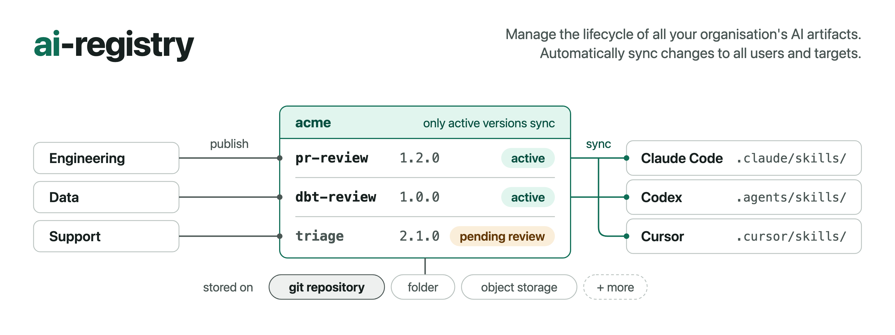

<p align="center">
  
</p>

<p align="center">
  <a href="https://github.com/atlanai/ai-registry/actions/workflows/ci.yml"></a>
  <a href="https://atlanai.github.io/ai-registry/"></a>
  <a href="https://github.com/atlanai/ai-registry/releases"></a>
  <a href="LICENSE"></a>
</p>

<p align="center"><strong>An open specification to build agent registries.</strong></p>

## What is ai-registry?

An agent registry stores your organization's AI artifacts and manages their lifecycle. It's the source of truth for the skills and agents your teams share, so everyone works from the same verified version of each skill and agent, no matter what team they're on or harness they use. However, registries today are often tied to one ecosystem or one vendor's storage, so only that vendor's tools can read your artifacts, and moving them means a migration.

**ai-registry is an open standard that enables anyone to build an open, interoperable agent registry.**

- **Open format:** Today each registry, and each coding agent's own store, has its own format for versions, ownership and approvals, so every client needs a connector per registry. With an open specification, a client integrates once, reads any registry that implements it, and installs into any downstream harness.
- **Open storage:** Today a registry is tied to its own storage, so its records can only be read through that registry's software. With an open specification, a registry is just a set of files in a defined layout, so you can build one on infrastructure you already have, such as a git repository or an object storage bucket. The aireg CLI reads registries in folders and git repositories today.

## Get started

The easiest way to get started is to follow the [Quickstart](https://atlanai.github.io/ai-registry/quickstart/).

To have your coding agent set up ai-registry for you, paste this prompt into Claude Code, Codex or Cursor:

```text
Set me up with ai-registry: https://github.com/atlanai/ai-registry
```

The agent follows the setup skill in this repository, [`skills/ai-registry/SKILL.md`](skills/ai-registry/SKILL.md). It asks before it installs aireg and the aireg skills, offers to try the example registry, then helps you set up a registry for yourself or your team. [The use cases](skills/ai-registry/references/use-cases.md) have more prompts to try, from your own coding agents to a whole team.

Install the aireg CLI on macOS or Linux:

```sh
curl -fsSL https://aireg.sh/install | sh
```

On Windows, run this in PowerShell:

```powershell
irm https://aireg.sh/install.ps1 | iex
```

Check the installation with `aireg --version`. To read the install script first, or to install a specific release, see [Install the aireg CLI](https://atlanai.github.io/ai-registry/quickstart/#install-the-aireg-cli). To run aireg from source, see [CONTRIBUTING.md](CONTRIBUTING.md#cli).

Then install the skills and agents from the example registry in this repository into a new project:

```sh
mkdir try-aireg && cd try-aireg && git init
aireg registry add github.com/atlanai/ai-registry --path examples/acme-registry
aireg add acme/engineering
aireg list
```

aireg links them into the folders your coding agents read, and records each exact version in `.registry/manifest.lock.yml`.

When it runs in a terminal, the installer offers the aireg skills, from the release it installs. They let your coding agent set up, install from and publish to registries for you. To add them later:

```sh
aireg registry add github.com/atlanai/ai-registry --path examples/aireg -g
aireg add ai-registry/aireg -g
```

## Roadmap

The ai-registry project currently includes:

- **[Registry file spec](spec/file-spec.md).** The specification you can use to implement an agent registry, with its JSON Schemas.
- **[aireg](cli/README.md).** A CLI client for the specification that creates registries, publishes to them and installs from them into Claude Code, Codex and Cursor.
- **[Example registries](examples/README.md) and [checks](tools/)** you can use to verify a registry against the spec.

The spec is a draft (v0.1) and aireg hasn't reached 1.0, so both may still make breaking changes. We plan to add a catalog API for creating, federating and governing registries, and an MCP server that lets an agent read a registry directly.

## Contributing

Start with [CONTRIBUTING.md](CONTRIBUTING.md), which covers bug reports, spec changes and setting up the CLI. Coding agents should read [AGENTS.md](AGENTS.md).

Everyone taking part follows the [Code of Conduct](CODE_OF_CONDUCT.md). Report security issues privately, as described in [SECURITY.md](SECURITY.md).

## License

ai-registry is licensed under the [Apache License 2.0](LICENSE).
