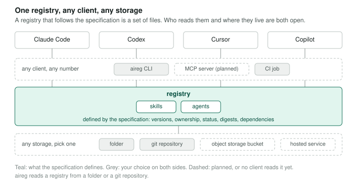

# Overview

**An open specification that anyone can use to build their own registry for AI artifacts like skills and agents.**

Agent registries manage the lifecycle and distribution of an organization's AI artifacts. They're often tied to one ecosystem or one vendor's infrastructure. An open specification lets you build a registry on the infrastructure you already have, and use it with every coding agent. [New to agent registries?](what-is-an-agent-registry.md)

**Open.** Today, each registry has its own format for artifact lifecycle metadata like versioning, ownership, and approvals, so clients need a specific connector for each registry. With an open registry specification, clients integrate with the specification once and can read from any registry that implements it.

**Portable.** Today, each registry is also tied to its own storage layer, so its records can only be read through that registry's software and cannot move to other storage without it. With an open registry specification, a registry is just a set of files in a defined layout, so it can live in and move between any storage you already have, including an object storage bucket, a git repository, or a hosted service that implements the specification. The aireg CLI reads registries in folders and git repositories today.

<figure markdown="span">
  
</figure>

## What the project includes

- **File spec.** The layout of a registry as files: a discovery document, an index, a pointer per artifact, an immutable record per version, and the artifact's own files. [Read the file spec](https://github.com/atlanai/ai-registry/blob/main/spec/file-spec.md) for more details.
- **aireg CLI.** A client to create and publish registries, manage artifacts, and automatically sync registry artifacts with downstream targets like Claude Code and Codex.

### Planned

- **Catalog API.** How registries are created, federated across teams and organizations, and governed. Clients keep reading files; the catalog manages them.
- **MCP server.** Lets an agent read a registry directly, with nothing installed.

## Start here

-   **What is an agent registry?**

    ---

    What you can do with one, and why it matters.

    [:octicons-arrow-right-24: What is an agent registry?](what-is-an-agent-registry.md)

-   **Teams and organisations**

    ---

    One registry for a whole company.

    [:octicons-arrow-right-24: Teams and organisations](use-cases/teams.md)

-   **Individuals**

    ---

    One person, several coding agents and machines.

    [:octicons-arrow-right-24: Individuals](use-cases/individuals.md)

-   **Quickstart**

    ---

    Build your own registry in nine steps, from install to background sync.

    [:octicons-arrow-right-24: Quickstart](quickstart.md)

